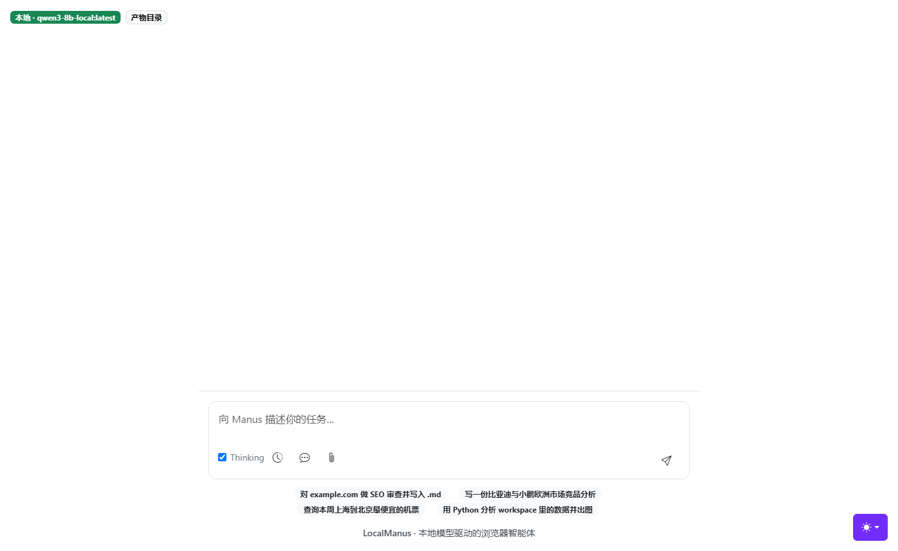

# LocalManus · 本地模型驱动的浏览器智能体

> 给一句话任务，它自己开浏览器、自己读页面、自己写文件、自己收尾——**模型全程跑在本机，不花一分钱云端 token。**



这个仓库记录的是把一套通用 Agent 运行时**在自己机器上从零重建**的过程：模型适配、配置优先级、提示词契约、工具兜底、循环保护、验证工具链，每一层都是为了让「7B/8B 的本地模型」真的能驱动工具调用而写的——上游框架默认假设你有一个听话的云端大模型，而这两件事之间隔着十几处必踩的坑。

上游基线：[FoundationAgents/OpenManus](https://github.com/FoundationAgents/OpenManus)（MIT）。本仓库在它之上重做了「无云端 key、只有本地小模型」这一整条路径：改动清单见 [第 2 节](#2-从-0-搭起来的那一层改了什么)，问题记录见 [第 5 节](#5-踩坑与修复从现象到根因)。

---

## 0. 先看结果

| 验证项 | 结果 |
| --- | --- |
| 本地模型端到端写文件 | ✅ 2 步 / 15.0 s，产出 `workspace/verify_write.md` |
| 浏览器取数 + 落盘 | ✅ 4 步 / 49.3 s，产出 `workspace/verify_browser.md`（`Example Domain`） |
| 真实站点信息提取 | ✅ python.org，H1 + 6 个导航项，产出 `workspace/python_org.md` |
| Web UI（SSE 流式） | ✅ `:5172` 起服，`/health` 返回 `source=local`，任务完成并落盘 `workspace/web_task.md` |
| 浏览器进程卫生 | ✅ 任务跑完 Chromium 从 4 个进程回落到 0；强杀父进程后可用 `scripts/cleanup_browsers.py` 精确回收 |
| Web UI 状态复位 | ✅ 三个场景 PASS：建任务失败不再锁死、SSE 断线自动对账解锁、真跑任务 36 s 正常收尾 |
| 环境自检 | ✅ `FAIL=0 WARN=3`（3 个警告全是可选依赖） |
| 单元测试 | ✅ `14 passed`（文本归一 4 + 循环保护 4 + 进程守卫 4 + Web 清理 2） |

原始数据由脚本生成、可随时重跑，见 [`docs/verify_report.md`](docs/verify_report.md)；逐条轨迹见 [`docs/VERIFY.md`](docs/VERIFY.md)。
跑起来的模型：本机 Ollama `qwen3-8b-local:latest`（8.2B / Q4_K_M / 40960 ctx / 支持 tools），`base_url=http://localhost:11434/v1`。

---

## 1. 这个 Agent 到底怎么工作

Agent 的本质是一个被压缩到极简的循环：

```
think（模型决定做什么） → act（框架真的去做） → observe（把结果压回上下文） → 再 think
```

框架负责三件容易被忽略的事：**把工具描述翻译成模型能读的 JSON Schema**、**把工具返回值压成模型能消化的文本**、**在步数 / Token 耗尽时收尾而不是崩掉**。这三件事的细节决定了小模型能不能跑通。

```
                  ┌──────────── 用户 ────────────┐
                  │  CLI: python main.py --prompt │
                  │  Web: python app.py  :5172    │
                  │       （SSE 流式看每步）        │
                  └──────────────┬───────────────┘
                                 │
                     ┌───────────▼────────────┐
                     │   Manus (ToolCallAgent) │
                     │  think → act → observe  │  ← max_steps + 循环保护
                     └───────────┬────────────┘
                                 │
     ┌──────────────┬────────────┼────────────┬──────────────┐
     ▼              ▼            ▼            ▼              ▼
 python_execute  browser_use  web_search  str_replace_editor  terminate
  （本机执行）    （Playwright）（百度/必应） （读写文件+文本归一） （收尾）
     │              │            │            │
     └──────────────┴─────┬──────┴────────────┘
                          ▼
                 ┌────────────────────┐
                 │  模型适配层          │  ← 本项目自建
                 │  app/local_llm.py  │
                 │ 探测 11434 → 打分   │
                 │ 选模型 → 视觉降级    │
                 └─────────┬──────────┘
                           ▼
              ┌───────────────────────────┐
              │ Ollama qwen3-8b-local     │
              │ （无本地模型时回落云端）    │
              └───────────────────────────┘
```

---

## 2. 从 0 搭起来的那一层：改了什么

上游给的是骨架：Agent 抽象、工具基类、ReAct 循环。但骨架默认「LLM 端随时可用、参数听话、模型有钱」。真正让它在这台机器上跑起来，需要自建下面八层，每层都有明确的判据。

| # | 模块 | 解决的问题 | 代码位置 | 怎么验证有效 |
| --- | --- | --- | --- | --- |
| 1 | **模型适配层** | 没 API key 直接崩；本机明明有 Ollama 却用不上；视觉模型缺失导致整条链路挂掉 | `app/local_llm.py` | `--list-models` 列出 3 个模型并给出推荐；`/health` 返回 `source=local` |
| 2 | **配置优先级** | 命令行 `--cloud` 覆盖不了配置文件里的「本地优先」；`api_key` 为空时 pydantic 直接抛 ValidationError | `app/config.py` | `--local` / `--cloud` / 环境变量三态生效；未配 key 只打印人话提示 |
| 3 | **提示词契约** | 模型不知道「今天」几号；把结果只打印在对话里不落盘；用相对路径写文件被工具拒绝 | `app/prompt/manus.py` | 日期类任务不再把「6 月 26 日」算成 2023 年；产物稳定出现在 `workspace/` |
| 4 | **工具层兜底** | 少装一个可选依赖整个包 `import` 失败；小模型把换行写成字面量 `\n`；纯文本模式只给元素列表，模型看不见正文 | `app/tool/__init__.py`、`app/tool/str_replace_editor.py`、`app/tool/browser_use_tool.py` | 缺 `crawl4ai` 仍能启动；多行文档落盘后是真多行；每步提示词里带 1200 字页面正文 |
| 5 | **循环保护** | 8B 模型在真实站点上「同一个 `go_to_url` 连点 5 次」，把步数预算烧光 | `app/agent/toolcall.py` | 连续同参动作到阈值即注入换策略提示，到硬阈值直接收尾 |
| 6 | **验证工具链** | 「跑通了」全靠肉眼，换台机器 / 隔天就复现不了 | `scripts/check_env.py`、`scripts/verify.py`、`tests/` | 一条命令出报告：步数、耗时、产物、PASS/FAIL |
| 7 | **进程卫生** | 任务报错时浏览器不关；Windows 父进程退出不级联杀子进程，Chromium 常驻后台 | `app/tool/proc_guard.py`、`app.py`、`app/tool/browser_use_tool.py` | 跑完任务后 `ms-playwright` 下的 chrome 进程数回落到 0；`scripts/cleanup_browsers.py` 可兜底 |
| 8 | **前端任务状态机** | 建任务请求失败 / SSE 断线后，界面永久锁在 working，再发消息只弹 `Chat bot still under working` | `static/main.js`、`templates/index.html` | 失败即复位；断线先查后端对账；10 s 看门狗 + 手动「重置」，界面不可能卡死 |

---

## 3. 从 0 到 1 的推进路径

阶段 0 是拆解，之后六步是搭建。按「先把不可控因素一个个钉死，再拼整车」的顺序推进，每个阶段都有明确的过关判据。

### 阶段 0 · 拆解：把黑盒切成四个能单独验证的部件

先不写业务代码，把「Agent 跑起来」拆成四个可独立验证的假设：

1. 本机能起一个**说 OpenAI 协议**的模型服务；
2. 这个模型**能输出结构化的 tool call**（不是只会聊天）；
3. 框架能**把工具结果压回上下文**并继续下一轮；
4. 任务结束时**有产物落盘**，而不是只在终端打印。

判据：四条都单独验证过，再谈「跑通」。

### 阶段 1 · 最小闭环：先不碰浏览器

第一个任务刻意选了「纯本地、不联网、只要写文件」。这一跑就暴露了两个问题：工具名对但**路径参数是相对路径**被拒、**新建文件却用了 `str_replace`** 而不是 `create`。这两条不是模型笨，是提示词里没写清楚契约——于是有了阶段 3。

判据：一次运行里 `str_replace_editor` 成功落盘 + `terminate` 正常收尾。

### 阶段 2 · 模型接入：写一个会「挑模型」的适配层

不想在每个入口都写一遍「先试试 Ollama，不行再用云端」。把这套逻辑收敛到一个不依赖 `app.config` 的模块里，避免循环导入：

- `GET /api/tags`，1.5 s 超时，失败静默返回（探测场景不该抛异常）；
- 只保留 `capabilities` 含 `tools` 的模型——Agent 必须能 function calling，这是硬门槛；
- 打分：`qwen3` > `qwen2.5` > `qwen` > `deepseek` > `llama`，`coder` 扣分（系统提示词长，代码模型指令遵循偏弱），参数量越大越优先；
- 有 VL 模型（`vl` / `llava` / `vision`）就把视觉一起切本地，没有就**显式降级为纯文本浏览器模式**并打印出来；
- 完全没有可用本地模型 → 回落 `config.toml` 的云端配置，并打印「需要 API Key」的可执行提示，而不是抛 SDK 异常。

判据：`python main.py --list-models` 能列模型并给推荐；`/health` 能报出模型来源。

### 阶段 3 · 提示词契约：把「模型该怎么做」写成规则

踩坑后回写进提示词的规则，每条都对应一次真实失败：

| 规则 | 对应失败 |
| --- | --- |
| 注入当前日期 | 模型把「6 月 26 日」解析成 2023 年 |
| 写文件必须绝对路径，新建用 `create` | 相对路径被拒 / 用 `str_replace` 改不存在的文件 |
| 要求写入工作目录并回报绝对路径 | 报告只出现在对话里，磁盘上找不到 |
| 多行内容用真实换行 | 落盘后整篇挤成一行、带一串 `\n` |
| 图形控件（日历 / 滑块）优先构造带参 URL，先访问首页建会话再跳深链 | 日历格子索引对不上，20 步全耗在猜索引 |
| 连续两次失败必须换策略 | 同一个动作反复重试 |

### 阶段 4 · 工具层兜底：让「缺东西」不致命

- **可选依赖懒加载**：`crawl4ai` / `browsergym` / `datasets` 只被特定工具用，改成 `__getattr__` 惰性导入后，少装一个不再让 `import app` 整个失败；
- **文本归一**：`normalize_multiline_text()` 在写入前把「字面量换行」还原成真换行，判据保守（出现 ≥2 次 `\n` 且完全没有真换行才动手），避免误伤「本来就要写字面量 `\n`」的场景，配套 4 条单测；
- **页面正文压缩注入**：`get_current_state()` 额外读一次 `body` 的可见文本，压成一行、截断 1200 字符塞进每步提示词。只给可交互元素列表时，模型看不到标题和正文，会误判「页面没打开」而反复导航——这是 5.7 那个空转的直接诱因。

### 阶段 5 · 循环保护：给步数预算加保险

真实站点上复现出的现象：模型连续 5 次 `go_to_url` 到同一个 URL，10 步预算烧光，一个产物都没有。

在 `ToolCallAgent.act()` 里加动作指纹（工具名 + 参数按键排序后的 JSON）：

- 连续重复到 `loop_soft_limit=3` → 往上下文注入一条「换策略」提示；
- 到 `loop_hard_limit=5` → 记日志、写清楚卡在哪、直接收尾，不把步数浪费光。

判据：`tests/test_loop_guard.py` 4 条单测覆盖指纹归一与连击计数；实测同一任务从「10 步烧光、零产物」变成「4 步认输」或「8 步完成」（取决于是否补上阶段 4 的正文注入）。

### 阶段 6 · 服务化与验证：把「跑通了」变成可复验

- `GET /health`：模型来源 + 视觉策略 + 任务数，前端左上角徽标直接读它；
- `GET /workspace/files`：列出产物，Web UI 可直接下载；
- `scripts/verify.py`：跑固定用例 → 用 loguru sink 数「Executing step N/M」拿步数、`perf_counter` 拿耗时、**文件快照对比**拿产物，最后追加一份 Markdown 报告；
- `scripts/cleanup_browsers.py`：浏览器进程救援工具（默认只看不动手），配合 `--orphans` / `--kill` / `--watch`；
- `tests/`：不依赖 LLM 的纯单测，秒级跑完。

为什么不用 `agent.current_step` 数步数？因为跑满 `max_steps` 时它会被重置为 0，报告会写着「0 步完成」——这种假数据比没有数据更糟。

---

## 4. 快速开始

### 4.1 环境

- Python 3.11 ~ 3.13（本次实测 3.13.14）
- 本地模型：Ollama（推荐）；没有也能跑，填云端 key 即可

> **Windows 中文路径坑**：项目路径含中文时，`python -m venv` 会在 `ensurepip` 阶段失败（exit 107）。虚拟环境放**纯英文路径**，本项目实测：
> `C:\Users\huangan\venvs\openmanus`

```bash
# 1) 建环境（英文路径！）
python -m venv C:/Users/huangan/venvs/openmanus
C:/Users/huangan/venvs/openmanus/Scripts/python.exe -m pip install -U pip -i https://pypi.tuna.tsinghua.edu.cn/simple

# 2) 装依赖（本仓库提供实测可用的锁定集合）
C:/Users/huangan/venvs/openmanus/Scripts/python.exe -m pip install -r requirements-local.txt \
  -i https://pypi.tuna.tsinghua.edu.cn/simple

# 3) 浏览器内核（browser_use 工具需要）
C:/Users/huangan/venvs/openmanus/Scripts/python.exe -m playwright install chromium
C:/Users/huangan/venvs/openmanus/Scripts/python.exe -m playwright install winldd   # Windows 必需

# 4) 自检
C:/Users/huangan/venvs/openmanus/Scripts/python.exe scripts/check_env.py
```

### 4.2 模型

不配置也能跑：启动自动探测本机 Ollama。

```
[config] 使用本地模型 qwen3-8b-local:latest (8.2B) @ http://localhost:11434/v1
[config] 视觉状态：本地无视觉模型，已降级为纯文本浏览器模式
```

手动指定：

```bash
python main.py --list-models                       # 列本机模型 + 推荐主脑
python main.py --local --model qwen2.5-coder-7b-local:latest
python main.py --cloud                             # 强制走 config.toml 云端配置
OPENMANUS_USE_LOCAL=1 python main.py               # 环境变量方式
```

本地没模型又想用自己的 key：填 `config/config.toml` 的 `[llm] api_key`，或设 `DASHSCOPE_API_KEY`。

### 4.3 跑起来

```bash
# CLI（调试首选，日志全在终端）
python main.py --local --max-steps 10 --prompt "打开 https://www.python.org ，提取 H1 与 3 个导航项，写入 workspace/python_org.md"

# 跑批任务建议加 --headless：不弹窗，也不会留下可见的浏览器进程
python main.py --local --headless --max-steps 8 --prompt "…"

# Web UI（SSE 流式看每步 think/act，左上角有「本地 / 云端」徽标）
python app.py     # → http://localhost:5172
```

> 启动方式注意：**必须用 `python app.py`**。用 `uvicorn app:app` 会与项目内的 `app/` 包重名，报 `Attribute "app" not found in module "app"`。

### 4.4 验证、测试与进程清理

```bash
python scripts/check_env.py                 # 环境自检
python scripts/verify.py                    # 端到端用例 → 追加 docs/verify_report.md
python scripts/verify.py --case browser     # 只跑浏览器用例
python -m pytest                            # 纯单测，秒级

python scripts/cleanup_browsers.py          # 看看有没有残留的 Chromium（只看不动手）
python scripts/cleanup_browsers.py --orphans # 只清父进程已退出的孤儿
python scripts/cleanup_browsers.py --kill   # 全清（含正在跑的 Agent 浏览器）
```

UI 状态机的回归（需要先 `python app.py` 起服务）：

```bash
python scripts/repro_stuck_ui.py --scenario create-fail   # 建任务失败后能否复位
python scripts/repro_stuck_ui.py --scenario sse-drop      # SSE 丢事件后能否对账解锁
python scripts/repro_stuck_ui.py --scenario real          # 真跑一个任务，确认正常路径没坏
# 三个场景都可以加 --expect-fixed，PASS/FAIL 由脚本退出码给出
```

> `pytest.ini` 已把 `tests/sandbox/`（上游留下、需要 Docker）排除在外：本项目默认不启用沙箱，那批用例在本机跑不出结果。

---

## 5. 踩坑与修复：从现象到根因

按「现象 → 怎么定位 → 根因 → 怎么修 → 怎么确认修好了」写，只保留真实发生过的。

### 5.1 `venv` 创建失败：`exit 107`

- **现象**：`python -m venv .venv` 在含中文的路径下直接失败，报 `ensurepip` 相关错误，退出码 107。
- **定位**：换到 `C:\Users\...` 下的纯英文目录再建一次，立即成功 → 与依赖无关，是路径编码问题。
- **根因**：Windows 下 `ensurepip` 在非 ASCII 路径上写临时脚本失败。
- **修复**：虚拟环境固定在 `C:\Users\huangan\venvs\openmanus`，项目本身放在含中文的目录里照样能跑。
- **确认**：`Scripts\python.exe -V` 正常输出 3.13.14。

### 5.2 依赖版本的「三角撕扯」：`eval_type_backport`

- **现象**：`import mcp` 抛 `ImportError: cannot import name 'eval_type_backport'`；单独 import pydantic 却正常。
- **定位**：`pip show` 发现装 `daytona-sdk` 时 pydantic 被顺带顶到 2.14；`mcp==1.5.0` 依赖 pydantic 2.10 内部的 `_typing_extra.eval_type_backport`，2.11+ 已移除该符号。
- **修复**：把 `pydantic==2.10.6` + `pydantic_core==2.27.2` 钉死写进 `requirements-local.txt`，并在 `check_env.py` 里加一条版本探测（不是 2.10.x 就 WARN 并说明原因）。
- **确认**：`[OK] pydantic 版本 — 2.10.6`，15 个核心依赖全部可导入。

### 5.3 Web UI 起不来：漏了 `jinja2`（还有一处同名坑）

- **现象 1**：`python app.py` 报 `Jinja2Templates` 相关断言失败。
- **根因**：上游 `requirements.txt` 里没有 `jinja2`，但 `app.py` 用了 `Jinja2Templates`。
- **现象 2**：改用 `uvicorn app:app` 又报 `Attribute "app" not found in module "app"`。
- **根因**：项目根目录的 `app.py` 与 `app/` 包同名，`app:app` 解析到了包。
- **修复**：补 `jinja2` 进依赖；启动方式统一为 `python app.py`（内部自己 `uvicorn.run`）。
- **确认**：`/` 返回 200，`/health` 返回 `source=local`。

### 5.4 少装一个可选依赖，整个包 `import` 失败

- **现象**：`import app` 直接抛 `No module named 'crawl4ai'`。
- **定位**：`app/tool/__init__.py` 顶层把所有工具都硬导入了，而 `Crawl4aiTool` 只在少数场景用。
- **修复**：改成 `__getattr__` 惰性导入，真正用到时才 import；缺 `crawl4ai` / `browsergym` / `datasets` 只降级对应工具。
- **确认**：自检里 3 个可选依赖均为 `WARN`，主流程 `FAIL=0`。

### 5.5 `str_replace_editor` 的两次失败：路径与命令用错

- **现象**：第 3 步传相对路径被拒 `The path ... is not an absolute path`；第 4 步改成绝对路径又报文件不存在。
- **根因**：工具只接受绝对路径；且 `create` 用于新建、`str_replace` 需要目标已存在，模型把两者搞混了。
- **修复**：提示词里把契约写死（绝对路径 + 新建用 `create` + 结束回报路径）。
- **确认**：同样的任务从「3 次尝试才落盘」变成「1 次落盘」，用时从 82 s 降到 30 s 量级。

### 5.6 多行文档落盘后挤成一行：8B 模型写字面量 `\n`

- **现象**：要求写「三条要点，每行一条」，落盘文件打开是一行，里头还有一串字面量 `\n`。
- **定位**：看 `🔧 Tool arguments` 日志，`file_text` 里就是 `\\n`（反斜杠 + n 两个字符），不是换行符——**模型在 JSON 参数里做了二次转义**。
- **第一次尝试（失败）**：在提示词里加「请使用真实换行」。复跑仍然照旧 → 说明 7B~8B 模型对这类格式约束的遵循度不够，靠提示词解决不了。
- **修复**：在工具写入前做保守归一 `normalize_multiline_text()`——只在「出现 ≥2 次字面量 `\n` 且完全没有真实换行」时还原 `\n` / `\r\n` / `\t`，避免误伤原本就想写字面量 `\n` 的场景（比如让 Agent 写一段 Python 源码）。
- **确认**：`tests/test_text_normalize.py` 4 条单测全绿；复跑同一任务，文件变成真正的三行。
- **沉淀**：这是「提示词管策略、工具层管兜底」的分工——**能靠代码保证的，不要赌模型的服从性**。

### 5.7 真实站点上原地打转：同一动作连点 5 次

- **现象**：python.org 任务第一次跑，10 步预算全部耗在 `go_to_url("https://www.python.org")` 上，273 s 后没有任何产物。
- **定位**：日志里连续 5 条完全相同的 `Tool arguments`；模型每步都「重新打开页面」而不是「读当前页面」，说明它没把「已经在这个页面上了」当成事实。
- **修复**：`ToolCallAgent.act()` 里加动作指纹与连击计数：连续 3 次同参 → 注入「换策略 / 换入口 / 直接收尾」提示；连续 5 次 → 记录卡点并收尾。阈值做成字段（`loop_soft_limit` / `loop_hard_limit`），便于按模型调。
- **确认**：`tests/test_loop_guard.py` 4 条单测覆盖指纹归一（参数键序无关）与连击计数；加上保护后同一任务复跑两次，一次 4 步就主动 `terminate(status=failure)` 承认失败（87 s，不再烧满 10 步），一次 10 步拿到正确产物。
- **诚实说明**：小模型输出有随机性，不能断言「加了保护就一定不空转」；保护的作用是**把「烧光 10 步」变成「3~5 步内换路或收尾」**，让失败可控、可解释。

### 5.8 模型把「6 月 26 日」算成 2023 年

- **根因**：系统提示词里没有「今天」这个锚点，模型只能按训练数据的时间基线推。
- **修复**：`build_system_prompt()` 渲染时注入当前日期与工作目录。
- **确认**：相对时间（明天 / 下周一）换算不再跨年。

### 5.9 报告只在对话里，磁盘上找不到

- **根因**：提示词没约束「必须落盘」，模型认为「把内容回复给用户」就算完成。
- **修复**：把「写入工作目录 + 结束回报绝对路径」写成硬规则，并提供 `/workspace/files` 让产物可见、可下载。

### 5.10 浏览器首次启动报 `winldd ... PrintDeps.exe` 缺失

- **根因**：`playwright install chromium` 没有把 Windows 依赖探测工具 `winldd` 一起装好。
- **修复**：补 `playwright install winldd`。
- **有趣的细节**：第一次遇到时，是模型自己调 `python_execute` 执行这条命令把环境修好再继续的——算是「Agent 自愈」的一个真实样本。

### 5.11 视觉模型缺失不是缺陷，是设计选择

浏览器工具在本仓库里**主动丢弃截图**（只把 `[index]<type>text</type>` 元素列表喂给模型）。原因很实际：8B 文本模型的上下文有限，塞一张 130 KB 的 base64 截图只会挤掉真正有用的页面文本。

代价也明确：**纯图形控件（日历、滑块、canvas 地图）成功率低**，需要走「构造带参 URL / 调站点 API / 接 MCP」三条后路。日历类任务上验证过：直接深链没有会话上下文会被反爬拦（空白页），**先访问首页建会话、再跳深链**才稳定。

### 5.12 纯文本模式只喂元素列表，模型会「以为页面没加载」

- **现象**：加了循环保护后，python.org 任务仍然时好时坏——有一次 4 步就放弃（`terminate(status=failure)`），浏览器明明已经打开了页面。
- **定位**：打印每步的浏览器状态，`interactive_elements` 只有 1~2 条（导航链接），**页面的 H1、正文一个字都没在上下文里**。模型手里只有「一个链接」，自然认为「我要的内容还没加载出来」，于是重新导航。
- **修复**：`get_current_state()` 里多读一次 `page.inner_text("body")`，压成一行、截断 1200 字符，作为 `page_text` 放进每步提示词。选 1200 字符是权衡：太少抓不到关键信息，太多挤掉工具描述（截图方案更糟，一张 130 KB 的 base64 直接把上下文吃掉）。同时保留元素列表，点按类操作仍然可用。
- **确认**：复跑同一任务，8 步拿到 H1 与 6 个导航项（`Python / PSF / Docs / PyPI / Jobs / Community`），产物正确；`verify.py` 的 `browser` 用例稳定在 4 步通过。
- **沉淀**：这不是「提示词能解决的事」。**给模型的信息不全时，它会用重复动作去补信息**——先补信息，再谈约束。

### 5.13 关不掉的浏览器：任务报错后 Chromium 常驻后台

- **现象**：任务列表里没看到浏览器窗口，但风扇一直转、内存少了一截；打开任务管理器，`ms-playwright` 目录下挂着好几个 `chrome.exe` / `headless_shell.exe`，父进程已经不存在了。
- **定位**（三条，都验证过）：
  1. `app.py` 的 `run_task()` 把 `agent.cleanup()` 写在 `try` 的最后一行。模型 401 / Ollama 超时 / 工具异常，任意一步抛错就直接跳到 `except`，**清理永远不会执行**；
  2. `browser_use` 的工具在 `__del__` 里用 `asyncio.run(self.cleanup())`——在自己的事件循环里跑必然抛 `RuntimeError`；退化成「新建一个 loop 再关」，关的又是属于旧 loop 的传输层，等于没关；
  3. Windows 没有进程组语义，父进程退出不会级联杀子进程；而 browser_use 的启动参数里硬编码了 `--no-startup-window`、`--disable-background-timer-throttling`、`--disable-renderer-backgrounding`——**既不显示窗口，也不进后台节流**，于是它安静地全速空转，用户很难联想到是某个 Agent 留下的。
- **修复**（三层，缺一层都不够）：
  1. `run_task()` 改成 `try / except / finally`，清理放 `finally`，并给 `agent.cleanup()` 套 30 s 超时（清理本身也可能卡住）；
  2. `browser_use_tool.cleanup()` 给 `context.close()` / `browser.close()` 各加 15 s 超时，关不掉也继续往下走进程回收；`__del__` 不再假装能关异步资源，只做进程兜底；
  3. 新增 `app/tool/proc_guard.py`：浏览器启动前拍 PID 快照，清理时只回收「**本进程的子孙 + 快照之后新出现**」的浏览器进程。这条规则很关键——按路径无脑杀会误伤用户自己的 Chrome，也会误伤并发跑的另一个任务。
- **确认**：实测一次浏览器任务，运行中 `headless_shell.exe` 从 1 涨到 4，任务结束后回落到 0；守卫的集成验证是「启动 4 个 → 识别出属于本次的 4 个 → sweep 后剩 0」；没有残留时 `cleanup_browsers.py` 明确输出「没有发现」。
- **沉淀**：资源释放写在 `try` 末尾还是 `finally` 里，差的是一个常驻进程。**能被 GC 兜住的只有内存，进程和文件句柄不会被 GC 兜住。**

### 5.14 界面卡死：`Chat bot still under working, please wait...`

- **现象**：任务跑过一次之后，再点发送只弹这条英文提示，输入框、发送按钮全都还在，但**再也发不出去**；刷新页面就恢复。截图见 `docs/ui-stuck-before.png`。
- **定位**：问题在前端的状态机，不在模型也不在后端。`static/main.js` 里 `chat_state` 是唯一的互斥标志，`sendMessage()` 只要发现它不是 `'none'` 就直接 return。而把它「放回去」的只有 `complete` / `error` 两个 SSE 事件，其余所有失败路径都在放回之前就退出了：
  1. `createChat()` 的 `.catch` 只弹 toast——**建任务请求失败（后端没起、500、网络断）后永远停在 working**；
  2. `prompt` 为空的分支在 `toggle_chat_state('')` 之后 return，同样漏了复位；
  3. `eventSource.onerror` 重连 3 次仍然失败时，只提示「please try refreshing the page」，没有复位；
  4. 更隐蔽的一条：SSE 断了但任务其实已经 `completed`，旧代码在那个分支里写的是 `// TODO`，既不取结果也不解锁。
- **复现**：用 Playwright 拦 `POST /tasks` 返回 500，连点两次发送：
  ```
  POST /tasks 次数: 1 -> 1
  首次提示: 'backend not ready'
  二次提示: 'Chat bot still under working, please wait...'
  是否卡死: True
  ```
- **修复**（`static/main.js` + `templates/index.html`）：
  1. 收口：新增 `endChat()`，复位状态 + 清 `activeTaskId` + 停看门狗，**所有**结束路径（成功、失败、空输入、重连耗尽）统一走它；
  2. 对账：`reconcileTask()` 直接问 `/tasks/{id}`。SSE 断线先对账再决定重连——任务已 `completed` 就把结果补渲染出来，已 `failed` 就弹错误，服务重启导致 404 就明确告知并解锁；
  3. 看门狗：任务期间每 10 s 对一次账，SSE 丢事件也能自动解锁；超过 20 分钟仍在跑，提示去看日志（不硬杀）；
  4. 手动出口：忙时出现一个「重置」按钮（`btnReset`），确认后释放界面，任务在后台继续跑、产物照样落盘。
- **确认**：`scripts/repro_stuck_ui.py` 三个场景全 PASS——
  ```
  create-fail : POST 次数 1 -> 2，不再出现 still under working
  sse-drop    : 1 秒内解锁，且把后端结果补渲染出来，随后能继续发消息
  real        : 真跑一个 example.com 任务，36 s 完成，界面正常解锁
  ```
- **沉淀**：**用一个字符串做互斥标志时，它的「复位点」必须和「置位点」一样多。** 少一个分支，用户就得多按一次刷新——而用户并不知道要刷新。

---

## 6. 设计取舍

| 取舍 | 选择 | 代价 | 为什么 |
| --- | --- | --- | --- |
| 模型 | 本地 8B 优先，云端兜底 | 工具参数正确率低于云端大模型，长任务易跑偏 | 零 token 成本、数据不出本机；先把这条路走通，云端只当备份 |
| 感知 | 纯文本元素列表，不用截图 | 纯图形控件难操作 | 上下文预算有限，文本模式对 8B 模型更稳 |
| 步数 | `max_steps` 显式限流 + 循环保护 | 复杂任务可能被截断 | 本地推理慢，跑飞一次 5 分钟，限流比事后重跑便宜 |
| 文本归一 | 保守策略（≥2 次 `\n` 才动） | 极少数边界场景不会自动修 | 宁可漏修，也不能把用户真想写的字面量 `\n` 改掉 |
| 沙箱 | 默认关闭（`python_execute` 本机直跑） | 不能跑不可信代码 | 单机自用，Docker / Daytona 需要额外资源；要隔离时改 `[sandbox]` |
| 服务化 | FastAPI + SSE | 任务状态在内存，重启即丢 | 单机自用不需要数据库；流式看每步比轮询更适合调试 |

---

## 7. 目录结构

```
LocalManus-BrowserAgent/
├── app/
│   ├── agent/                 # Manus / ToolCallAgent（含循环保护）/ BrowserContextHelper
│   ├── tool/                  # 6 个内置工具；可选依赖懒加载；文本归一兜底
│   │   └── proc_guard.py      # 浏览器进程卫生：PID 快照、精确回收、孤儿扫描
│   ├── prompt/                # 中文系统提示词（日期注入、落盘契约、深链策略）
│   ├── local_llm.py           # 模型探测 / 打分 / 视觉降级 / 缺 key 提示
│   ├── config.py              # 配置单例（本地优先，环境变量可覆盖）
│   └── llm.py                 # OpenAI 兼容客户端 + token 统计
├── config/config.toml         # 模型、浏览器、搜索、服务端口
├── templates/ static/         # Web UI（模型来源徽标 + 产物入口 + 失败对账/重置）
├── app.py                     # FastAPI + SSE 任务流（清理放在 finally）
├── main.py                    # CLI（--local/--cloud/--model/--max-steps/--headless/--list-models）
├── scripts/
│   ├── check_env.py           # 环境自检（12 项，OK/WARN/FAIL）
│   ├── verify.py              # 端到端验证 → docs/verify_report.md
│   ├── repro_stuck_ui.py      # UI 状态机回归（建任务失败 / SSE 断线 / 真跑）
│   └── cleanup_browsers.py    # 浏览器进程排查与回收
├── cases/run_case.py          # 三类可复用任务模板（SEO / 竞品 / 机票）
├── tests/                     # 不依赖 LLM 的纯单测
├── docs/                      # 验证记录 + 报告 + 截图
└── workspace/                 # Agent 产物目录
```

---

## 8. 已知限制

- **纯文本浏览器模式**在纯图形控件上成功率低，需要「构造 URL / 调 API / 接 MCP」三条后路；
- **8B 本地模型**长任务稳定性不如云端大模型，建议 `--max-steps` 限流 + 把任务写具体；
- **收尾动作偶发缺失**：个别任务产物正确但没调用 `terminate`，靠步数耗尽结束（日志里能看到）；
- **搜索工具**依赖公开搜索引擎的 HTML 解析，百度 / 必应改版即失效；
- **无沙箱**时 `python_execute` 直接在本机执行，不要跑不可信代码；
- **进程清理**已经做到「正常路径必清理 + 异常路径 finally 清理 + 进程兜底」，但如果 Python 被 `taskkill /F` 或蓝屏级别的意外终止，仍可能留下 Chromium，这时用 `scripts/cleanup_browsers.py --orphans` 收尾；
- **Web UI 是单任务串行**：同一条对话同时只跑一个任务，多开标签页会各自起任务（后端没做全局排队）；「重置」只释放界面，**不会中断服务端那个任务**，产物仍会写进 `workspace/`；
- **任务状态存在内存**：服务重启后旧任务查不到，前端会提示「服务端已重启」并恢复输入，但那次对话的中间过程就看不到了；
- Windows 下退出阶段偶发 `unclosed transport` 噪声，来自 Proactor 事件循环回收浏览器子进程，不影响任务结果。

接下来想做的：把「同一动作连击」的判据从「完全相同参数」放宽到「同一 URL 同一动作」；给浏览器工具补一个 DOM 语义压缩层（用更少 token 表达更完整的页面）；把 `cases/` 里的任务固化成可对比的回归基线。

---

## 9. 上游与许可

- 上游：[FoundationAgents/OpenManus](https://github.com/FoundationAgents/OpenManus)（MIT），核心贡献来自 MetaGPT 社区；
- 浏览器能力基于 [browser-use](https://github.com/browser-use/browser-use) 与 Playwright；
- 本仓库保留上游 MIT 许可；新增 / 重写的是第 2 节表格里那八层，以及 `docs/`、`scripts/`、`tests/` 下的验证代码。
